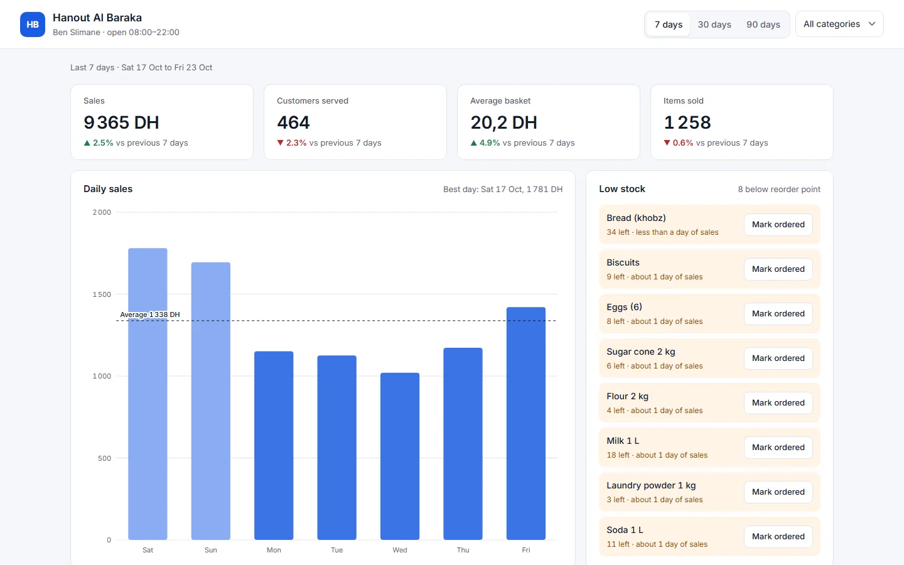

# Shop Dashboard

A sales and stock dashboard for a small neighbourhood shop, built with plain HTML, CSS and JavaScript. No frameworks, no chart libraries.

**Live demo:** https://iliasjf.github.io/shop-dashboard/



## Why I built it

I supervise a BIM store, so I see every day what a shop owner needs to know: how much we sold, when the shop is busy, what sells best, and what is about to run out. This dashboard answers those four questions on one screen, on a computer or a phone.

## What it does

- **Key numbers** for the last 7, 30 or 90 days: sales in dirhams, customers served, average basket and items sold, each compared with the previous period.
- **Daily sales chart** drawn in SVG, with weekends shown lighter, an average line and a tooltip for each day.
- **Busy hours heatmap**: average customers for every weekday and opening hour, to plan staff and deliveries.
- **Best sellers** ranked by sales.
- **Low-stock alerts**: products under their reorder point, sorted by how many days of sales are left. "Mark ordered" is remembered in the browser.
- **Category filter** (Bakery, Dairy, Pantry, Drinks, Household, Snacks) that updates everything.

## Sample data

The shop, Hanout Al Baraka in Ben Slimane, is fictional. `data.js` generates 90 days of transactions from a fixed seed, with a weekly rhythm (busier Friday to Sunday) and a daily one (after-work rush around 18:00–20:00), so the numbers are the same on every visit.

## Run it locally

Open `index.html` in a browser, or serve the folder:

```bash
python -m http.server
```

## Files

| File | What it holds |
| --- | --- |
| `index.html` | The page structure |
| `styles.css` | Layout, colours and the phone layout |
| `data.js` | Products and the sample sales generator |
| `app.js` | Calculations, the SVG chart, the heatmap, filters and stock alerts |

Built by [Ilias Jafaoui](https://iliasjf.github.io).
